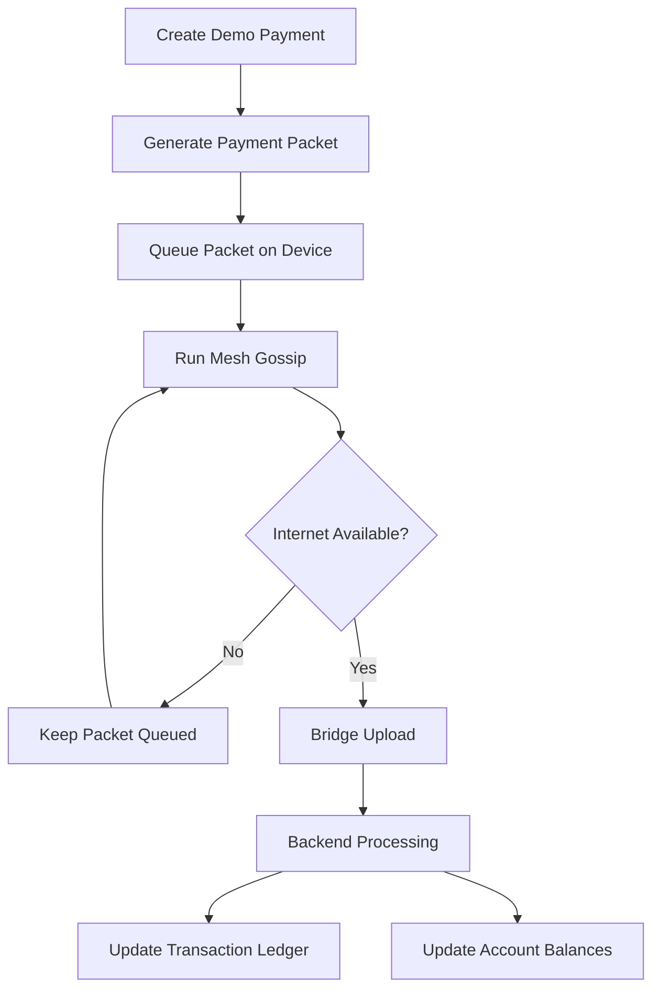

# UPI Without Internet — Offline Mesh Payment Demo

<p align="center">
  <strong>Exploring offline digital payments through device-to-device communication and mesh networking.</strong>
</p>

<p align="center">
  
  
  
  
</p>

---

## 📸 Dashboard Preview


## 📌 Overview

**UPI Without Internet** is an educational prototype that demonstrates how digital payment packets can move between devices when internet connectivity is unavailable and later reach a backend through a device that regains connectivity.

The project simulates offline payments using device mesh networking, packet gossip, bridge uploads, and duplicate-packet handling.

> ⚠️ This is a demonstration project. It does not connect to the live UPI network or perform real bank transfers.

## ✨ Features

- 💸 Offline payment simulation
- 📱 Device-to-device mesh communication simulation
- 🔄 Gossip rounds for exchanging queued packets
- 🌐 Bridge uploads to the backend
- 👛 Demo account balances
- 📊 Transaction ledger and status monitoring
- 🛡️ Idempotency and duplicate-packet handling demonstration
- 📦 Queued packet monitoring
- 📥 Transaction CSV export
- 📝 Activity logging

## 🛠️ Tech Stack

- **Java 20** — Application runtime
- **Spring Boot** — Backend framework
- **Maven** — Build and dependency management
- **HTML, CSS, JavaScript** — Dashboard interface
- **Thymeleaf** — Server-side template rendering

## 🔄 How It Works



## 🚀 Getting Started

### Prerequisites

- Java 20
- Git
- A web browser

### 1. Clone the Repository

```bash
git clone https://github.com/perryvegehan/UPI_Without_Internet.git
cd UPI_Without_Internet
```

### 2. Run the Application

**Windows:**

```powershell
.\mvnw.cmd spring-boot:run
```

Alternatively, if Maven is installed:

```bash
mvn spring-boot:run
```

**macOS / Linux:**

```bash
chmod +x mvnw
./mvnw spring-boot:run
```

### 3. Open the Dashboard

Open your browser and visit:

**http://localhost:8080**

Keep the application running in your terminal.

## 🧪 Demo Walkthrough

1. Select the sender account.
2. Select the receiver account.
3. Enter the payment amount.
4. Enter the configured demo PIN.
5. Click **Inject payment into mesh**.
6. Click **Run gossip round** to simulate packet exchange.
7. Click **Upload to backend** to exercise the bridge workflow.
8. Check the transaction ledger and account balances.

Use only the demo accounts and test PIN configured in the application.

## 🔌 API Endpoints

| Method | Endpoint | Description |
|---|---|---|
| GET | `/api/mesh/state` | Retrieve mesh state |
| GET | `/api/accounts` | Retrieve demo accounts |
| GET | `/api/transactions` | Retrieve transactions |
| POST | `/api/demo/send` | Create a demo payment |
| POST | `/api/mesh/gossip` | Run a gossip round |
| POST | `/api/mesh/flush` | Attempt bridge uploads |
| POST | `/api/mesh/reset` | Reset mesh and cache state |

These endpoints are documented based on the current project description. Check the backend source code to verify their exact request formats and behavior.

## 📂 Project Structure

```text
UPI_Without_Internet/
├── docs/
│   └── dashboard.png
├── src/
│   └── main/
│       ├── java/
│       └── resources/
│           └── templates/
│               └── dashboard.html
├── mvnw
├── mvnw.cmd
├── pom.xml
└── README.md
```

## 🔐 Security and Limitations

- This project does not perform real UPI transactions.
- Demo balances do not represent real money.
- Mesh networking and offline payment behavior are simulated.
- Demo PINs must not be reused as real credentials.
- Production deployment would require secure device authentication, encryption, replay protection, durable storage, transaction reconciliation, and regulatory compliance.
- Do not expose development endpoints publicly without proper access controls.

## 🔮 Future Improvements

- Bluetooth and Wi-Fi Direct communication
- Persistent offline transaction storage
- Cryptographic device authentication
- Reliable retry and reconciliation mechanisms
- Automated testing for duplicate packets
- Improved connectivity recovery
- Production deployment and monitoring

## 🤝 Contributing

Contributions, bug reports, and suggestions are welcome.

1. Fork the repository.
2. Create a feature branch.
3. Commit your changes.
4. Open a pull request.

## 📄 License

No license is specified in this README. Add a `LICENSE` file to define the permissions for using, modifying, and distributing the project.

---

<p align="center">
  Built as an educational exploration of offline-first payments and mesh networking.
</p>
